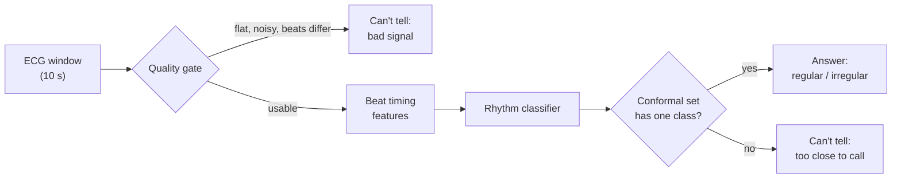
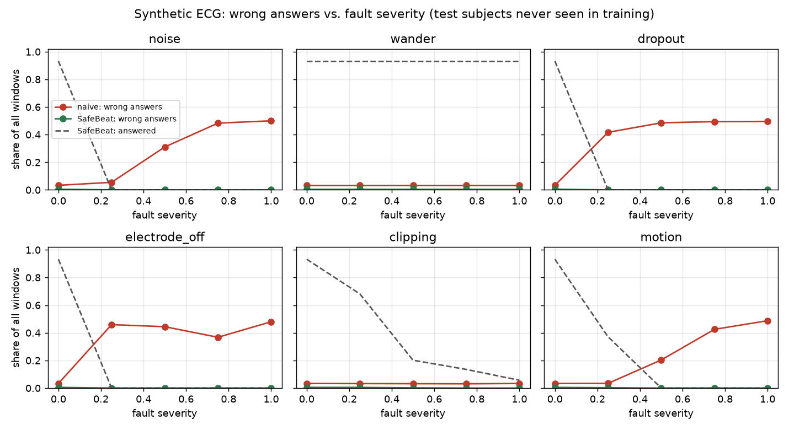

# SafeBeat: a heart-rhythm screener that knows when not to trust itself

[](https://github.com/Madmaxcoder2612/safebeat/actions/workflows/ci.yml)


Wearable ECG models usually give a confident answer even when the signal is junk: a loose electrode, a dropout, movement. SafeBeat adds two safety layers in front of a simple rhythm classifier, a **signal-quality gate** and an **"I'm not sure" rule**, and tests them the way safety engineers test: by **injecting faults** and counting the wrong answers.

It comes with a **browser lab** where you damage a signal with sliders and watch a naive model keep answering while SafeBeat holds back.

> **Teaching demo, not a medical device.** Every signal is synthetic, generated by code in this repository. Nothing here is clinically validated, and it must not be used to make health decisions. Damage strengths are chosen for teaching and not measured on real devices. See [Limitations](#limitations).

## Contents

- [The idea](#the-idea)
- [Results in numbers](#results-in-numbers)
- [Results at a glance](#results-at-a-glance)
- [The browser lab](#the-browser-lab)
- [Quick start](#quick-start)
- [How it works](#how-it-works)
- [Repository layout](#repository-layout)
- [Third-party material](#third-party-material)
- [Privacy and EU rules](#privacy-and-eu-rules)
- [Limitations](#limitations)
- [Next steps](#next-steps)

## The idea



The gate learns its limits from **clean signals only**. It never sees a faulty signal while it is being set up. The "not sure" rule is split conformal prediction: on a calibration set, record how wrong the model is on the true class, take a high quantile, and answer only when exactly one class stays within it (90% target on clean data).

## Results in numbers

Synthetic data, 30 test people the model never saw (1,200 ten-second windows), default gate setting.

| | Naive model | SafeBeat |
|---|---|---|
| Clean signal, wrong answers | 3.3% | 0.5% (answers 93% of windows) |
| Electrode lifts off, wrong answers | 37 to 48% | 0% (holds back) |
| Lost samples (dropout), wrong answers | 42 to 50% | 0% (holds back) |
| Strong electrical noise, wrong answers | 31 to 50% (at strength 0.5 and up) | 0% (holds back) |
| Movement artefact, strength 0.5 and up | 20 to 49% | 0% (holds back) |
| Baseline drift | 3.3% | 0.5% (answers, with a warning) |

Safety has a price. At default strictness SafeBeat refuses a lot: for light movement (strength 0.25) it answers only 37% of windows, and for light noise (0.25), where the naive model is hardly hurt (5.5% wrong), it refuses all of them. A looser gate answers more and also answers wrong more often, as the chart below shows.

## Results at a glance

**Wrong answers against damage strength.** Red is the naive model, green is SafeBeat, dashed grey is how often SafeBeat answers at all.



*Figure 1. Test people were never seen in training. Source table: [results/fault_sweep.csv](results/fault_sweep.csv).*

**Safety against availability.** Each dot is one gate strictness level, from strictest (left) to loosest (right). Loosening the gate buys more answers at the cost of more wrong ones, and for heavy movement the cost is steep.


*Figure 2. Source table: [results/margin_sweep.csv](results/margin_sweep.csv).*

## The browser lab

The lab lives in [lab/](lab/). Open `lab/index.html`, or serve the folder and open it:

```bash
python -m http.server 8765 --directory lab
```

Then browse to `http://localhost:8765`. Pick a person, a damage type, a damage strength and a gate strictness, and compare the two verdicts.

The page does no machine learning of its own. [safebeat/export_lab.py](safebeat/export_lab.py) runs the real Python code on four example windows, damages each with every fault at eleven strengths, records the verdicts, and writes them to `lab/data.js`. The page replays them. It makes no network requests (see [Privacy and EU rules](#privacy-and-eu-rules)).

## Quick start

Requires Python 3.10 or newer.

```bash
git clone https://github.com/Madmaxcoder2612/safebeat.git
cd safebeat
python -m venv .venv
```

Activate the environment (`.venv\Scripts\activate` on Windows, `source .venv/bin/activate` elsewhere), then install the packages:

```bash
pip install -r requirements.txt
```

Run the tests (22 tests, about 10 seconds):

```bash
python -m pytest -q
```

Train, calibrate, sweep the faults and write the tables and charts to `results/` (a few minutes):

```bash
python -m safebeat.evaluate
```

Rebuild the lab data (about 5 minutes). Its numbers come from a finer grid with fresh random damage, so they differ from the tables above by a percent or two:

```bash
python -m safebeat.export_lab
```

Check that the lab cannot contact any server:

```bash
python tools/check_lab_offline.py
```

## How it works

| File | Role |
|---|---|
| [safebeat/synth.py](safebeat/synth.py) | Synthetic ECG: five Gaussian bumps per beat, a regular and an irregular rhythm, one simulated person per subject |
| [safebeat/faults.py](safebeat/faults.py) | Six fault injectors with a strength from 0 to 1 |
| [safebeat/features.py](safebeat/features.py) | Beat detector and six beat-timing numbers |
| [safebeat/model.py](safebeat/model.py) | Logistic regression on those numbers |
| [safebeat/quality.py](safebeat/quality.py) | The gate: reject checks and soft warnings, limits learned from clean data |
| [safebeat/abstain.py](safebeat/abstain.py) | SafeBeat: gate plus conformal "I'm not sure" rule |
| [safebeat/evaluate.py](safebeat/evaluate.py) | Subject-wise split, fault sweep, gate-strictness sweep, charts |
| [safebeat/export_lab.py](safebeat/export_lab.py) | Precomputes everything the lab shows |
| [tools/check_lab_offline.py](tools/check_lab_offline.py) | Fails if the lab contains an outside address or a network or storage call |

The gate checks: a flat line, fast noise, uneven beat heights, beats that do not look alike (a template correlation), and an implausible beat count. Slow drift and clipping only raise a warning, because they do not move beat timing for this detector.

GitHub Actions runs the tests and the offline check on every push.

## Repository layout

```text
.
├── safebeat/              Generator, faults, features, model, gate, abstain rule, evaluation
├── tests/                 Unit tests
├── tools/                 Offline check for the lab
├── lab/                   Browser lab (HTML, CSS, JS, precomputed data)
├── results/               Generated tables and charts
└── .github/workflows/     CI
```

## Third-party material

Nothing is copied into this repository. The packages below are installed by `pip` when you run the code and are not redistributed here.

| Package | Used for | Licence |
|---|---|---|
| NumPy | Arrays | BSD-3-Clause |
| SciPy | Filters, peak finding, spectra | BSD-3-Clause |
| scikit-learn | Logistic regression | BSD-3-Clause |
| matplotlib | Charts in `results/` (drawn with its bundled DejaVu font, a permissive licence) | matplotlib licence (PSF-style) |
| pytest | Tests | MIT |

The lab uses no third-party fonts, scripts, images or icons, only the system font stack and hand-written SVG.

**No real patient data is used.** Every signal is generated by [safebeat/synth.py](safebeat/synth.py), written for this project. The beat model (a sum of Gaussian bumps) is a common textbook idea; the numbers are invented.

## Privacy and EU rules

- The lab sets a **Content-Security-Policy** that blocks all network connections and all outside scripts, styles, fonts and images. It uses no cookies, no local storage, no analytics and no tracking. [tools/check_lab_offline.py](tools/check_lab_offline.py) runs in CI to keep it that way.
- The repository holds no personal data beyond the author's name in the licence. Commits use a GitHub noreply address.
- If you host the lab on a web host (for example GitHub Pages), the **host** may log visitor IP addresses. The lab itself collects nothing. A public website may also need an Impressum under German law; that depends on who runs it and why, and this README is not legal advice.
- Not a medical device. See [Limitations](#limitations).

## Limitations

- **All data is synthetic.** Real ECG is messier, with other rhythms, other morphologies and other failure modes. Results on real recordings may be worse. This version has not been tried on real data.
- **The gate was designed while looking at these six faults.** I added the beat-shape check after movement artefact fooled the first version, and made drift and clipping warnings after they proved harmless to this detector. The table shows the design works on these faults, not that it generalises to faults nobody tried.
- **Movement artefact is the hardest fault.** With a looser gate, heavy movement gives up to 18% wrong answers (Figure 2).
- **Strict by default.** The default gate refuses light noise and light movement that barely hurt the naive model. That is the safety-versus-availability trade-off, not a free win.
- **The 90% promise holds for clean data only.** Conformal coverage assumes the new window looks like the calibration data. Damaged signals break that assumption, which is why the gate runs first.
- **Assumes calibrated amplitude.** A real device would need its own gate limits.
- **Simple and small.** Two rhythm classes, one lead, ten-second windows, a basic beat detector, a logistic regression.
- **Damage strengths are made up** for teaching and are not measured on real devices.
- **Not a medical device.** No clinical validation, no regulatory review, no claim of diagnostic use.

## Next steps

1. Check the abstain behaviour on real recordings. The open [MIT-BIH Arrhythmia Database](https://physionet.org/content/mitdb/1.0.0/) (Open Data Commons Attribution License v1.0) is the candidate; it would need a download script (no raw data in the repository), the three citations the page asks for, and a decision first.
2. Test faults the gate was not designed against, and report what it misses.
3. Tune the gate per fault instead of one strictness knob for all checks.
4. Write a short safety case for the abstain function: hazards, detection, residual risk.

## License

[MIT](LICENSE)
