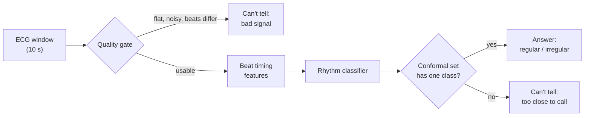
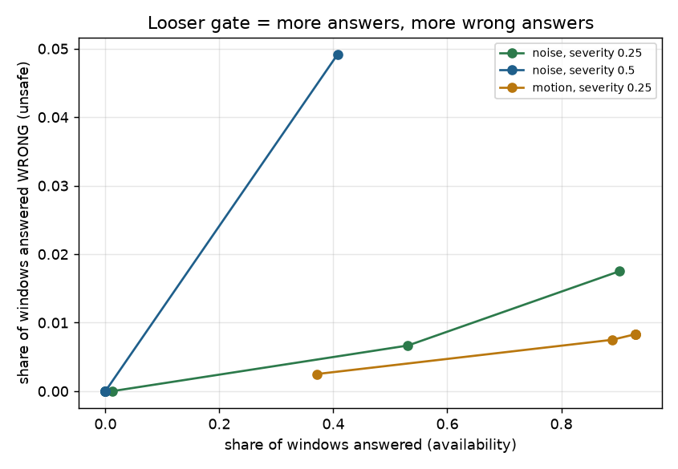
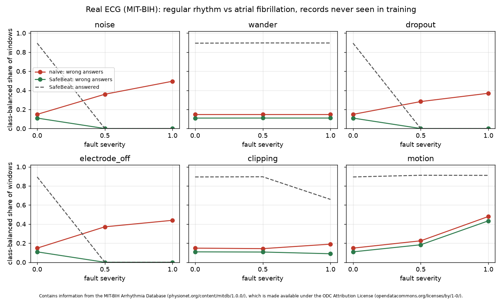
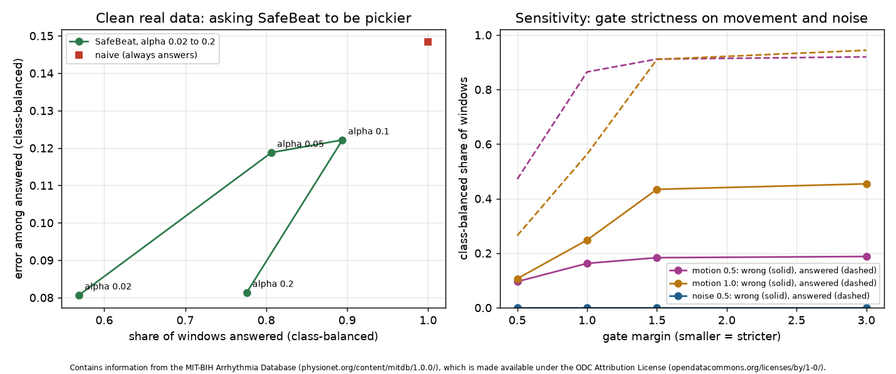

# SafeBeat: a heart-rhythm screener that knows when not to trust itself

[](https://github.com/Madmaxcoder2612/safebeat/actions/workflows/ci.yml)


Wearable ECG models usually give a confident answer even when the signal is junk: a loose electrode, a dropout, movement. SafeBeat adds two safety layers in front of a simple rhythm classifier, a **signal-quality gate** and an **"I'm not sure" rule**, and tests them the way safety engineers test: by **injecting faults** and counting the wrong answers.

It comes with a **browser lab** where you damage a signal with sliders and watch a naive model keep answering while SafeBeat holds back.

> **Teaching demo, not a medical device.** The lab and the main experiments use synthetic signals generated by code in this repository. A separate [real-data check](#real-data-check-mit-bih) uses the open MIT-BIH Arrhythmia Database, credited below. Nothing here is clinically validated, and it must not be used to make health decisions. Damage strengths are chosen for teaching and not measured on real devices. See [Limitations](#limitations).

## Contents

- [The idea](#the-idea)
- [Results in numbers](#results-in-numbers)
- [Results at a glance](#results-at-a-glance)
- [Real-data check (MIT-BIH)](#real-data-check-mit-bih)
- [The browser lab](#the-browser-lab)
- [Quick start](#quick-start)
- [How it works](#how-it-works)
- [Repository layout](#repository-layout)
- [Third-party material](#third-party-material)
- [Privacy and EU rules](#privacy-and-eu-rules)
- [Limitations](#limitations)
- [Next steps](#next-steps)

## The idea



The gate learns its limits from **clean signals only**. It never sees a faulty signal while it is being set up. The "not sure" rule is split conformal prediction: on a calibration set, record how wrong the model is on the true class, take a high quantile, and answer only when exactly one class stays within it (90% target on clean data).

## Results in numbers

Synthetic data, 30 test people the model never saw (1,200 ten-second windows), default gate setting.

| | Naive model | SafeBeat |
|---|---|---|
| Clean signal, wrong answers | 3.3% | 0.5% (answers 93% of windows) |
| Electrode lifts off, wrong answers | 37 to 48% | 0% (holds back) |
| Lost samples (dropout), wrong answers | 42 to 50% | 0% (holds back) |
| Strong electrical noise, wrong answers | 31 to 50% (at strength 0.5 and up) | 0% (holds back) |
| Movement artefact, strength 0.5 and up | 20 to 49% | 0% (holds back) |
| Baseline drift | 3.3% | 0.5% (answers, with a warning) |

Safety has a price. At default strictness SafeBeat refuses a lot: for light movement (strength 0.25) it answers only 37% of windows, and for light noise (0.25), where the naive model is hardly hurt (5.5% wrong), it refuses all of them. A looser gate answers more and also answers wrong more often, as the chart below shows.

## Results at a glance

**Wrong answers against damage strength.** Red is the naive model, green is SafeBeat, dashed grey is how often SafeBeat answers at all.


*Figure 1. Test people were never seen in training. Source table: [results/fault_sweep.csv](results/fault_sweep.csv).*

**Safety against availability.** Each dot is one gate strictness level, from strictest (left) to loosest (right). Loosening the gate buys more answers at the cost of more wrong ones, and for heavy movement the cost is steep.



*Figure 2. Source table: [results/margin_sweep.csv](results/margin_sweep.csv).*

## Real-data check (MIT-BIH)

> Contains information from the [MIT-BIH Arrhythmia Database](https://physionet.org/content/mitdb/1.0.0/), which is made available under the [ODC Attribution License](https://opendatacommons.org/licenses/by/1-0/). Full credit and citations: [NOTICE](NOTICE).

The synthetic study shows the idea works on data I generated, with faults I also wrote. This check asks the harder question: does it hold on real ECG? The task is **regular rhythm** (cardiologist-labelled normal sinus rhythm) against **atrial fibrillation** (AF). Details that matter:

- 44 recordings (four paced ones skipped), cut into 10-second windows. 2,353 regular and 703 AF windows were tested, after capping regular windows per record.
- **Records are split, never windows.** A record is entirely in training, calibration or test, in three rotations, so every record is tested once. Gate limits and "can't tell" thresholds come from training and calibration records only.
- **AF appears in only 7 records.** AF numbers rest on very few people, so treat them as indicative.
- Results are class-balanced (average of the regular and AF rates), so "always say regular" cannot look good.
- The same six faults are applied to the real windows. The data changes made (resampling, scaling, labelling) are listed in [safebeat/realdata.py](safebeat/realdata.py) and [NOTICE](NOTICE).

Class-balanced results, default setting, records never seen in training:

| Situation | Naive: wrong | SafeBeat: wrong | SafeBeat: answered |
|---|---|---|---|
| Clean | 14.8% | 10.9% | 89% |
| Strong noise (0.5, 1.0) | 36%, 50% | 0%, 0% | 0%, 0% |
| Lost samples (0.5, 1.0) | 28%, 37% | 0%, 0% | 0%, 0% |
| Electrode lifts (0.5, 1.0) | 37%, 44% | 0%, 0% | 0%, 0% |
| Baseline drift (1.0) | 14.8% | 11.0% | 90% |
| Clipping (0.5, 1.0) | 14%, 19% | 11%, 9% | 90%, 66% |
| **Movement (0.5, 1.0)** | **23%, 48%** | **18%, 43%** | **91%, 91%** |

What this says, without softening it:

- **The gate works on real data for noise, lost samples and a lifted electrode.** It refuses every damaged window, where the naive model is 28 to 50% wrong. This is the strongest real-data result.
- **The "can't tell" rule helps only a little on clean real data.** SafeBeat is 10.9% wrong against 14.8%, partly just by refusing about 11% of windows. The classifier itself is weak: it sees only beat timing, and real "regular" windows contain stray beats. Per class on clean data: the naive model is wrong on 13.3% of regular and 16.4% of AF windows; SafeBeat answers 90% and 89% of them and is wrong on 11.9% and 10.0%.
- **Movement artefact fools the gate on real data.** SafeBeat answers 91% of windows and is almost as wrong as the naive model. On synthetic data the same fault was caught, so that result did not carry over.



*Figure 3. Class-balanced, records never seen in training. Source: [results/real_mitdb_results.csv](results/real_mitdb_results.csv). Contains information from the MIT-BIH Arrhythmia Database, which is made available under the ODC Attribution License; see [NOTICE](NOTICE).*

**Sensitivity checks** (separate from the results above, and not tuned): they show what two knobs do, and I did not choose a setting from them and report it as the result.

- **Stricter gate against movement.** With a smaller gate margin (0.5, stricter), movement errors fall to about 10% at both strengths, and clean-data answers drop only from 89% to 85%. That looks promising, but picking it from this table would be tuning on the test faults. The honest next step is to choose the margin on separate validation records.
- **A pickier "can't tell" level (alpha).** Answering fewer windows lowers the error among answered windows (for example 57% answered with 8.1% error at alpha 0.02), but the trend is bumpy, because the AF calibration set is small. Do not read a smooth curve into it.



*Figure 4. Source: [results/real_mitdb_sensitivity.csv](results/real_mitdb_sensitivity.csv). Contains information from the MIT-BIH Arrhythmia Database, which is made available under the ODC Attribution License; see [NOTICE](NOTICE).*

## The browser lab

The lab lives in [lab/](lab/). Open `lab/index.html`, or serve the folder and open it:

```bash
python -m http.server 8765 --directory lab
```

Then browse to `http://localhost:8765`. Pick a person, a damage type, a damage strength and a gate strictness, and compare the two verdicts.

The page does no machine learning of its own. [safebeat/export_lab.py](safebeat/export_lab.py) runs the real Python code on four example windows, damages each with every fault at eleven strengths, records the verdicts, and writes them to `lab/data.js`. The page replays them. It makes no network requests (see [Privacy and EU rules](#privacy-and-eu-rules)).

## Quick start

Requires Python 3.10 or newer.

```bash
git clone https://github.com/Madmaxcoder2612/safebeat.git
cd safebeat
python -m venv .venv
```

Activate the environment (`.venv\Scripts\activate` on Windows, `source .venv/bin/activate` elsewhere), then install the packages:

```bash
pip install -r requirements.txt
```

Run the tests (30 tests, about 10 seconds; the few that need the MIT-BIH recordings skip themselves if you have not downloaded them):

```bash
python -m pytest -q
```

Train, calibrate, sweep the faults and write the tables and charts to `results/` (a few minutes):

```bash
python -m safebeat.evaluate
```

Optional real-data check. This downloads the open MIT-BIH recordings (90 MB) from PhysioNet into `data/`, which git ignores, then runs the evaluation (about 5 minutes). Keep the notice from [NOTICE](NOTICE) next to any result you show from this data:

```bash
python tools/download_mitdb.py
python -m safebeat.evaluate_real
```

Rebuild the lab data (about 5 minutes). Its numbers come from a finer grid with fresh random damage, so they differ from the tables above by a percent or two:

```bash
python -m safebeat.export_lab
```

Check that the lab cannot contact any server:

```bash
python tools/check_lab_offline.py
```

## How it works

| File | Role |
|---|---|
| [safebeat/synth.py](safebeat/synth.py) | Synthetic ECG: five Gaussian bumps per beat, a regular and an irregular rhythm, one simulated person per subject |
| [safebeat/faults.py](safebeat/faults.py) | Six fault injectors with a strength from 0 to 1 |
| [safebeat/features.py](safebeat/features.py) | Beat detector and six beat-timing numbers |
| [safebeat/model.py](safebeat/model.py) | Logistic regression on those numbers |
| [safebeat/quality.py](safebeat/quality.py) | The gate: reject checks and soft warnings, limits learned from clean data |
| [safebeat/abstain.py](safebeat/abstain.py) | SafeBeat: gate plus conformal "I'm not sure" rule |
| [safebeat/evaluate.py](safebeat/evaluate.py) | Subject-wise split, fault sweep, gate-strictness sweep, charts |
| [safebeat/export_lab.py](safebeat/export_lab.py) | Precomputes everything the lab shows |
| [safebeat/realdata.py](safebeat/realdata.py) | Reads MIT-BIH recordings, resamples, scales, windows and labels them (changes listed in the file) |
| [safebeat/evaluate_real.py](safebeat/evaluate_real.py) | Record-wise folds, fault sweep and the two sensitivity checks on real data |
| [tools/download_mitdb.py](tools/download_mitdb.py) | Downloads the open MIT-BIH data from PhysioNet into `data/` (not committed) |
| [tools/check_lab_offline.py](tools/check_lab_offline.py) | Fails if the lab contains an outside address or a network or storage call |

The gate checks: a flat line, fast noise, uneven beat heights, beats that do not look alike (a template correlation), and an implausible beat count. Slow drift and clipping only raise a warning, because they do not move beat timing for this detector.

GitHub Actions runs the tests and the offline check on every push.

## Repository layout

```text
.
├── safebeat/              Generator, faults, features, model, gate, abstain rule, evaluation
├── tests/                 Unit tests
├── tools/                 Offline check for the lab, MIT-BIH download script
├── lab/                   Browser lab (HTML, CSS, JS, precomputed data)
├── results/               Generated tables and charts (real-data ones carry the credit notice)
├── NOTICE                 Credits, licences and citations for third-party data and software
├── data/                  Created by the download script, not committed
└── .github/workflows/     CI
```

## Third-party material

Nothing is copied into this repository. The packages below are installed by `pip` when you run the code and are not redistributed here.

| Package | Used for | Licence |
|---|---|---|
| NumPy | Arrays | BSD-3-Clause |
| SciPy | Filters, peak finding, spectra | BSD-3-Clause |
| scikit-learn | Logistic regression | BSD-3-Clause |
| matplotlib | Charts in `results/` (drawn with its bundled DejaVu font, a permissive licence) | matplotlib licence (PSF-style) |
| wfdb | Reads the PhysioNet file format | MIT |
| pytest | Tests | MIT |

The lab uses no third-party fonts, scripts, images or icons, only the system font stack and hand-written SVG.

**Data.** The lab and the main experiments use only synthetic signals from [safebeat/synth.py](safebeat/synth.py), written for this project. The beat model (a sum of Gaussian bumps) is a common textbook idea; the numbers are invented.

The [real-data check](#real-data-check-mit-bih) uses the **MIT-BIH Arrhythmia Database**, which is not included in this repository and is not redistributed. The recordings are downloaded from PhysioNet by whoever runs the check. Only derived tables and charts are published here.

> Contains information from the [MIT-BIH Arrhythmia Database](https://physionet.org/content/mitdb/1.0.0/), which is made available under the [ODC Attribution License](https://opendatacommons.org/licenses/by/1-0/).

Licence: Open Data Commons Attribution License v1.0 (Open Access). Please cite, as PhysioNet asks:

1. Moody, G., & Mark, R. (2005). MIT-BIH Arrhythmia Database (version 1.0.0). PhysioNet. RRID:SCR_007345. https://doi.org/10.13026/C2F305
2. Moody GB, Mark RG. The impact of the MIT-BIH Arrhythmia Database. IEEE Eng in Med and Biol 20(3):45-50 (May-June 2001). (PMID: 11446209)
3. Pollard, T., Moody, B. E., Lehman, L., Gow, B., Fernandes, C., Xie, C., Johnson, A., Mark, R. G., & Heldt, T. (2026). PhysioNet as a global platform for biomedical research. Nature Health. https://doi.org/10.1038/s44360-026-00096-z

The authors and PhysioNet do not endorse this project. The complete list, including every change made to the data, is in [NOTICE](NOTICE).

## Privacy and EU rules

- The lab sets a **Content-Security-Policy** that blocks all network connections and all outside scripts, styles, fonts and images. It uses no cookies, no local storage, no analytics and no tracking. [tools/check_lab_offline.py](tools/check_lab_offline.py) runs in CI to keep it that way.
- The repository holds no personal data beyond the author's name in the licence. Commits use a GitHub noreply address.
- The MIT-BIH recordings are historical hospital recordings that PhysioNet publishes as open access. They are not stored or republished here, and nothing in this project tries to identify anyone. I did not find a de-identification statement on the PhysioNet page I read, so that point is not independently verified.
- If you host the lab on a web host (for example GitHub Pages), the **host** may log visitor IP addresses. The lab itself collects nothing. A public website may also need an Impressum under German law; that depends on who runs it and why, and this README is not legal advice.
- Not a medical device. See [Limitations](#limitations).

## Limitations

- **The lab and the main experiments use synthetic data.** Real ECG is messier, with other rhythms, other morphologies and other failure modes. The [real-data check](#real-data-check-mit-bih) shows that some results hold (noise, lost samples, lifted electrode) and some do not (movement).
- **The real-data check is small.** Atrial fibrillation appears in only 7 records, there is one dataset, one lead and two rhythm classes, and the regular windows were subsampled. It is indicative, not conclusive.
- **On clean real data the classifier is weak and the "can't tell" rule helps only a little** (10.9% wrong against 14.8%).
- **The gate was designed while looking at the synthetic faults.** I added the beat-shape check after movement artefact fooled the first version, and made drift and clipping warnings after they proved harmless to this detector. The tables show the design works on these faults, not that it generalises to faults nobody tried.
- **Movement artefact is the hardest fault.** It fools the default gate on real data. A stricter gate helps in the sensitivity check, but I have not chosen that setting on separate validation data. With a looser gate on synthetic data, heavy movement gives up to 18% wrong answers (Figure 2).
- **Strict by default.** The default gate refuses light noise and light movement that barely hurt the naive model. That is the safety-versus-availability trade-off, not a free win.
- **The 90% promise holds for clean data only.** Conformal coverage assumes the new window looks like the calibration data. Damaged signals break that assumption, which is why the gate runs first.
- **Assumes calibrated amplitude.** A real device would need its own gate limits.
- **Simple and small.** Two rhythm classes, one lead, ten-second windows, a basic beat detector, a logistic regression.
- **Damage strengths are made up** for teaching and are not measured on real devices.
- **Not a medical device.** No clinical validation, no regulatory review, no claim of diagnostic use.

## Next steps

1. Choose the gate margin and the "can't tell" level on separate validation records, then re-test on untouched records, so a stricter movement check is not tuned on the test faults.
2. Add features that see more than beat timing (for example P-wave and beat-shape features) so the classifier itself is stronger on real data.
3. Test faults the gate was not designed against, and report what it misses.
4. Try more rhythm classes and a second open dataset.
5. Write a short safety case for the abstain function: hazards, detection, residual risk.

## License

[MIT](LICENSE)
